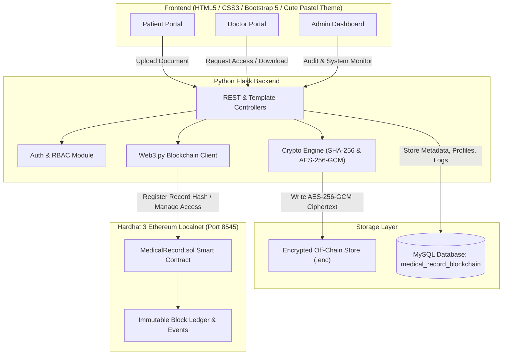

# MediChain – Medical Record Management System

> **"Your Health Records. Your Control. Secured by Blockchain."**  
> B.Tech Information Science Mini-Project | Full-Stack Healthcare DApp

---

## 1. Project Introduction

**MediChain** is a decentralized, privacy-first Electronic Health Record (EHR) management web application. Designed with a welcoming, modern **Cute Pastel Healthcare Aesthetic** on the surface and backed by cryptographic guarantees underneath, MediChain combines **Ethereum-compatible Solidity smart contracts**, **AES-256-GCM symmetric document encryption**, **SHA-256 integrity verification**, and a relational **MySQL** database.

In traditional medical record architectures, patients have little transparency or control over who accesses their confidential diagnostic data, and centralized servers are single points of failure vulnerable to unauthorized tampering, data leaks, and ransomware. MediChain restores patient sovereignty by enforcing an off-chain/on-chain hybrid architecture: medical files are encrypted and stored securely off-chain, while immutable cryptographic fingerprints (SHA-256) and patient-controlled access permissions are managed directly by an Ethereum smart contract.

---

## 2. Problem Statement

1. **Centralized Vulnerabilities**: Traditional hospital EHRs store records in centralized databases susceptible to silent tampering, insider fraud, and data breaches.
2. **Lack of Patient Sovereignty**: Patients have no real-time transparency or granular control over which external physicians or healthcare providers can view or download their diagnostic reports.
3. **Data Integrity Hazards**: There is no mathematical mechanism for a doctor to guarantee that a medical report was not subtly altered (e.g., modified lab values or dosage changes) during transfer or storage.
4. **Intimidating UI/UX**: Existing medical software often features sterile, intimidating, and complex user interfaces that hinder patient engagement.

---

## 3. Project Objectives

- Implement an attractive, cute, modern, and accessible **Pastel Healthcare UI** using Bootstrap 5, custom CSS styling, and Google Fonts (Nunito & Poppins).
- Develop a dual-layer security architecture utilizing **AES-256-GCM** symmetric encryption for document storage and **SHA-256** for mathematical integrity proofs.
- Deploy a Solidity smart contract (`MedicalRecord.sol`) on an **Ethereum-compatible Hardhat localnet** to record document hashes and manage doctor access permissions.
- Build a Python Flask backend integrating with the smart contract using **Web3.py**.
- Enforce strict **Role-Based Access Control (RBAC)** across three distinct roles: **Patient**, **Doctor**, and **Administrator**.
- Implement real-time **Tamper Detection & Verification**, enabling any party to mathematically prove whether a medical file has been altered.
- Provide a full automated test suite covering all 15 operational test cases.

---

## 4. Proposed Solution & Architecture

MediChain implements an **Off-Chain / On-Chain Hybrid Model** complying with healthcare privacy standards (such as HIPAA and GDPR principles) where private patient identifiers and medical reports are **never** stored on the public blockchain:

1. **Client / Patient Upload**: When a patient uploads a medical file (PDF, PNG, JPG), the server computes its **SHA-256 hash** and encrypts the file bytes with a 256-bit symmetric key using **AES-256-GCM** with a random 96-bit nonce.
2. **Encrypted Storage**: The encrypted ciphertext is stored in an off-chain storage repository (`backend/uploads/encrypted/`).
3. **Relational Metadata**: The file metadata, encryption IV, and authentication tag are recorded in **MySQL**.
4. **Smart Contract Registration**: The document's SHA-256 digest, record ID, patient ID, and category are sent as an Ethereum transaction to `MedicalRecord.sol`.
5. **Patient-Governed Access**: Doctors search for patients by ID and submit access requests. The patient approves or revokes access directly on the blockchain state machine.
6. **Zero-Trust Verification**: When a record is inspected, the decrypted document's hash is recomputed and compared against the smart contract hash. Any change in file content produces an immediate verification failure.



---

## 5. Technology Stack

| Domain | Technology / Library | Version / Specification |
|---|---|---|
| **Frontend** | HTML5, CSS3, JavaScript, Bootstrap 5 | Bootstrap 5.3, Font Awesome 6.5, Google Fonts (Nunito) |
| **Backend** | Python, Flask, Werkzeug | Python 3.10+, Flask 3.1, Werkzeug (PBKDF2/Scrypt) |
| **Database** | MySQL / MariaDB | MariaDB 10.4+ / MySQL 8.0, PyMySQL driver |
| **Blockchain** | Solidity, Hardhat 3, Web3.py | Solidity 0.8.20, Hardhat 3.21.2, Web3.py 8.0 |
| **Document Encryption** | Cryptography (Python) | AES-256-GCM (12-byte Nonce, 16-byte Auth Tag) |
| **Integrity Proofs** | Cryptographic Hash Function | SHA-256 (256-bit hexadecimal digest) |
| **Testing** | Pytest & Hardhat Test Runner | 15 Python Automated Tests, 4 Solidity Unit Tests |

---

## 6. Color Palette & UI Design System

Inspired by clean, modern pastel healthcare software:

- **Pastel Pink**: `#FCE4EC` (Warmth, greeting banners, medical badges)
- **Soft Mint Green**: `#DDF5E3` (Verified state, success actions, clinical health)
- **Baby Blue**: `#DCEEFF` (Information banners, radiology/scan tags)
- **Lavender**: `#EAE2FF` (Secondary accents, blockchain identifiers, record IDs)
- **Cream White**: `#FFFDF8` (Background base with soft radial ambient mesh)
- **Soft Peach**: `#FFE8D6` (Pending requests, alerts, blood tests)
- **Primary Accent**: `#5EAA8D` / `#78BFA3` (Action buttons, primary highlights)
- **Dark Text**: `#344054` (High-contrast readability, typography)

---

## 7. Project Folder Structure

```
MediChain/
├── backend/
│   ├── app.py                         # Application factory & error handlers
│   ├── config.py                      # Environment and security configuration
│   ├── auth.py                        # RBAC decorators & unique ID generators
│   ├── crypto_utils.py                # SHA-256 hashing & AES-256-GCM encryption
│   ├── blockchain_client.py           # Web3.py client wrapper for smart contract
│   ├── contract_deployment.json       # Deployed contract ABI, address, and RPC info
│   ├── database/
│   │   ├── db.py                      # Database connection, queries & init/seed
│   │   └── schema.sql                 # MySQL schema DDL (8 tables)
│   ├── routes/
│   │   ├── main_routes.py             # Landing page & live verification API
│   │   ├── auth_routes.py             # Login, registration & logout
│   │   ├── patient_routes.py          # Upload, records, doctors, requests, profile
│   │   ├── doctor_routes.py           # Search, view records, download, requests
│   │   └── admin_routes.py            # User management, audit logs, ledger
│   ├── static/
│   │   └── css/
│   │       └── style.css              # Custom Cute Pastel Healthcare design system
│   ├── templates/
│   │   ├── base.html                  # Global layout, modal & toast scripts
│   │   ├── dashboard_layout.html      # Sidebar, navbar & live node status pill
│   │   ├── landing.html               # Responsive marketing & explanation landing
│   │   ├── auth/                      # Login & Registration views
│   │   ├── patient/                   # 6 Patient Portal templates
│   │   ├── doctor/                    # 7 Doctor Portal templates
│   │   └── admin/                     # 5 Admin Portal templates
│   └── uploads/
│       ├── encrypted/                 # AES-256-GCM encrypted document blobs
│       └── temp/                      # Temporary staging directory
├── blockchain/
│   ├── contracts/
│   │   └── MedicalRecord.sol          # Solidity smart contract
│   ├── scripts/
│   │   └── deploy.js                  # Deployment script targeting Hardhat node
│   ├── test/
│   │   ├── MedicalRecord.t.sol        # Hardhat 3 native Solidity test suite
│   │   └── MedicalRecord.test.js      # Ethers test suite
│   ├── hardhat.config.js              # Hardhat 3 ESM configuration
│   └── package.json                   # Node dependencies (Ethers, Hardhat 3)
├── tests/
│   └── test_medichain.py              # Automated 15-case pytest test suite
├── .env.example                       # Example environment file
├── .env                               # Active environment configuration
├── package.json                       # Root npm commands
├── requirements.txt                   # Python package dependencies
├── run.py                             # Main web application launcher
├── start.sh                           # One-step startup script
└── README.md                          # Complete project documentation
```

---

## 8. Database Design (`schema.sql`)

Database Name: `medical_record_blockchain`

### Tables:
1. **`users`**: Core authentication table with `user_id` (`ADM-001`, `PAT-2026-XXXX`, `DOC-2026-XXXX`), email, password hash, role (`patient`, `doctor`, `admin`), full name, phone, and active status.
2. **`patient_profiles`**: Clinical profile containing `patient_id`, date of birth, gender, blood group, emergency contact, allergies, and address.
3. **`doctor_profiles`**: Professional credentials containing `doctor_id`, specialization, medical license number, hospital affiliation, years of experience, and bio.
4. **`medical_records`**: Document metadata containing `record_id`, `patient_id`, title, category, original filename, encrypted filename, file size, MIME type, `file_hash` (SHA-256), `encryption_iv`, `encryption_tag`, `blockchain_tx_hash`, and block number.
5. **`access_requests`**: Record access permissions requested by doctors, containing `request_id`, `patient_id`, `doctor_id`, clinical purpose, status (`pending`, `approved`, `rejected`, `revoked`), and timestamps.
6. **`doctor_permissions`**: Active authorization lookup table between `patient_id` and `doctor_id` with `is_active` boolean flag.
7. **`audit_logs`**: System security trail recording `user_id`, `user_role`, `action`, `details`, IP address, and creation timestamp.
8. **`blockchain_transactions`**: Local mirror of on-chain receipts containing `tx_hash`, `block_number`, contract function, gas used, and entity IDs.

---

## 9. Smart Contract Architecture (`MedicalRecord.sol`)

The smart contract is written in **Solidity 0.8.20** and deployed to Hardhat localnet.

### Core Functions:
- `addMedicalRecord(string _recordId, string _patientId, string _documentHash, string _recordType)`: Registers a document hash and metadata on-chain. Ensures record ID uniqueness.
- `grantAccess(string _patientId, string _doctorId)`: Sets doctor authorization flag for the patient to `true`. Emits `AccessGranted`.
- `revokeAccess(string _patientId, string _doctorId)`: Sets doctor authorization flag to `false`. Emits `AccessRevoked`.
- `hasAccess(string _patientId, string _doctorId) external view returns (bool)`: Returns whether doctor has permission.
- `verifyRecord(string _recordId, string _candidateHash) external returns (bool isValid, string storedHash)`: Compares candidate SHA-256 hash with stored hash and emits `RecordVerified`.
- `getRecord(string _recordId) external view returns (...)`: Retrieves registered hash, timestamp, and metadata.

---

## 10. Installation & Setup Instructions

### Prerequisites
- **Node.js**: v22.13.0 or newer
- **Python**: 3.10 or newer (tested with Python 3.13)
- **MySQL / MariaDB**: Port 3306

### Step 1: Clone or Navigate to Project
```bash
cd /Users/deekshitha/Desktop/MediChain
```

### Step 2: Set Up Python Virtual Environment
```bash
python3 -m venv venv
source venv/bin/activate
pip install -r requirements.txt
```

### Step 3: Install Blockchain Dependencies
```bash
cd blockchain
npm install
npx hardhat compile
cd ..
```

### Step 4: Environment Variables Configuration
Copy `.env.example` to `.env` (already pre-configured with secure keys):
```bash
cp .env.example .env
```

---

## 11. How to Run the Application

You can start the entire system using the **one-step startup script** or manually in three terminal windows:

### Option A: One-Step Automated Startup
```bash
./start.sh
```

### Option B: Manual Startup

#### Terminal 1: Start MySQL / MariaDB
Ensure MySQL is running on port 3306. If using the provided local MariaDB:
```bash
/Applications/XAMPP/xamppfiles/sbin/mysqld --no-defaults --datadir=./mysql_data --socket=/tmp/medichain_mysql.sock --port=3306
```

#### Terminal 2: Start Hardhat Local Blockchain & Deploy Contract
```bash
cd blockchain
npx hardhat node --hostname 127.0.0.1 --port 8545
```
In a new tab, deploy the smart contract:
```bash
cd blockchain
node scripts/deploy.js
```

#### Terminal 3: Start Flask Web Server
```bash
source venv/bin/activate
python run.py
```

Open your browser at:  
👉 **`http://127.0.0.1:5001`**

---

## 12. Pre-Seeded Demo Credentials for Presentation / Viva

| Role | Email | Password | User ID | Features to Demo |
|---|---|---|---|---|
| **Patient** | `emily@example.com` | `Patient@123` | `PAT-2026-1001` | Upload files, approve/reject doctor requests, revoke access, verify integrity, test tamper simulation. |
| **Doctor** | `dr.sarah@example.com` | `Doctor@123` | `DOC-2026-2001` | Search patient `PAT-2026-1001`, send access request, view & download authorized records, verify hashes. |
| **Admin** | `admin@medichain.com` | `Admin@12345` | `ADM-001` | System statistics, Chart.js visualizer, activate/deactivate accounts, inspect blockchain transactions & audit logs. |

*Tip: The login page includes 1-click **Instant Viva Fill** buttons to autofill demo credentials with a single tap.*

---

## 13. Testing Instructions

### Run Python Automated Test Suite (15 Test Cases):
```bash
source venv/bin/activate
pytest tests/test_medichain.py -v
```

**Test Coverage Summary:**
- ✅ Test 1: Patient registration with auto-generated `PAT-2026-XXXX` ID.
- ✅ Test 2: Doctor registration with license and specialization.
- ✅ Test 3: Session login, role redirection, and safe logout.
- ✅ Test 4: Medical record upload, MIME validation, and size checks.
- ✅ Test 5: AES-256-GCM symmetric encryption with 96-bit nonce and authentication tag.
- ✅ Test 6: SHA-256 hash generation, determinism, and avalanche effect.
- ✅ Test 7: Real-time Solidity smart contract record registration on Hardhat localnet.
- ✅ Test 8: Doctor access request creation with clinical purpose.
- ✅ Test 9: Patient approval and smart contract permission update.
- ✅ Test 10: Patient rejection handling.
- ✅ Test 11: Patient revocation of doctor access on blockchain.
- ✅ Test 12: Enforcement of backend 403 blocking on unauthorized doctor access.
- ✅ Test 13: Cryptographic verification of genuine documents against blockchain hash.
- ✅ Test 14: Tamper detection identifying modified file bytes and hash mismatch.
- ✅ Test 15: Graceful error handling and diagnostic banner when blockchain node is offline.

### Run Solidity Smart Contract Tests (Hardhat 3):
```bash
cd blockchain
npx hardhat test
```
Result: `4 passing (4 solidity)`

---

## 14. Document Tampering Demonstration (Live Viva Demo)

1. Sign in as Patient `emily@example.com` / `Patient@123`.
2. In **My Medical Records**, click the **Verify** button next to any record.
3. Observe the green modal:
   - Status: **DOCUMENT VERIFIED ✓**
   - Blockchain Hash == Calculated Document Hash
4. Click the **Simulate Tampering** button (or bug icon).
5. The application modifies the document bytes and recalculates the SHA-256 hash:
   - Status: **INTEGRITY CHECK FAILED / TAMPERED ⚠️**
   - Blockchain Stored Hash: `c076389d5cfa...`
   - Calculated Tampered Hash: `81e4d068ba12...`
   - Mathematical proof that any unauthorized change is immediately detected.

---

## 15. Limitations

- **Local Network Scope**: The current deployment runs on a local Hardhat Ethereum node (`chainId: 31337`). Deployment to public testnets (e.g., Sepolia) would require an RPC provider (Infura/Alchemy) and funded gas wallets.
- **Key Storage**: The master AES encryption key is managed securely via server-side environment variables. In a multi-tenant enterprise deployment, hardware security modules (HSM) or envelope encryption with patient-held private keys can be added.
- **File Storage**: Encrypted files are stored on server disk storage.

---

## 16. Future Enhancements

- **IPFS / Filecoin Integration**: Distribute encrypted file blobs across decentralized IPFS nodes rather than localized storage.
- **Patient Proxy Re-Encryption (PRE)**: Allow patients to re-encrypt records for specific doctors using asymmetric elliptic curve cryptography (ECIES/PRE) without server decryption.
- **Zero-Knowledge Proofs (zk-SNARKs)**: Allow doctors to verify that a patient's test is within a normal range without revealing the exact numeric value.
- **Mobile Companion App**: Flutter or React Native mobile client for biometric face/fingerprint authentication.

---

## 17. Project Viva & Academic Defense Highlights

- **Off-chain vs On-chain clarity**: Why medical records are never placed directly on the blockchain (privacy compliance + block gas limits), while SHA-256 fingerprints provide full immutability.
- **Defense against SQL Injection**: 100% of SQL statements utilize parameterized queries via PyMySQL.
- **Defense against Tampering**: Proof-of-existence via Ethereum transaction receipts and cryptographic hash comparison.
- **Defense against Unauthorized Access**: Backend decorators verify both SQL session state and on-chain permission before serving any decrypted byte.

---
*MediChain – B.Tech Information Science Capstone Project*
